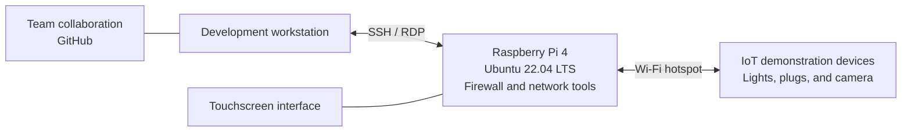
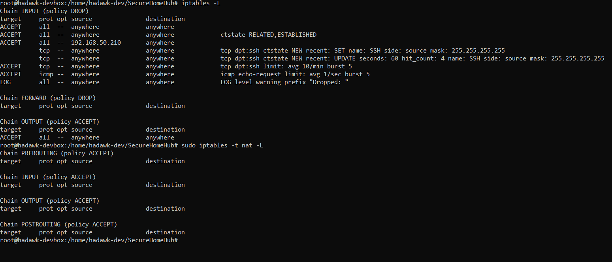
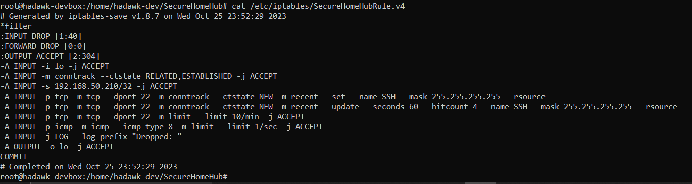
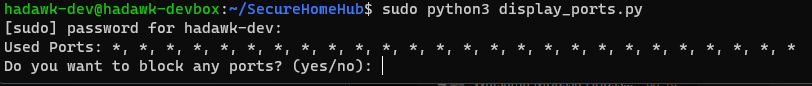
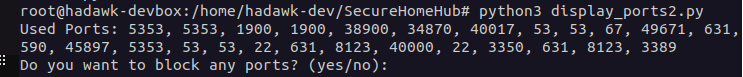
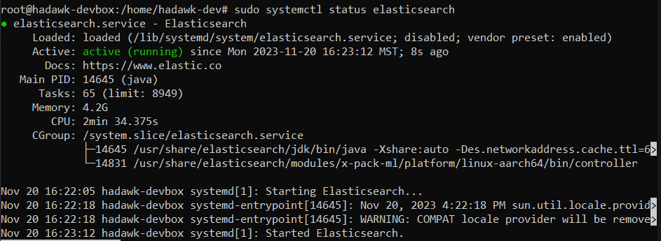

# Secure Home Hub

**SAIT Information Technology capstone · April–December 2023**  
**Southern Alberta Institute of Technology · Calgary, Alberta**  
**Kyle Fischer · Raspberry Pi security configuration**

Worked with a team of six to develop Secure Home Hub, a Raspberry Pi prototype for connecting and monitoring smart-home devices through a local hub. We combined physical hardware, networking, security tools, and a user interface. My responsibility was security configuration on the Raspberry Pi.

## My contribution

Worked on Linux firewall configuration, rule inspection, and troubleshooting for the Raspberry Pi. Started with iptables and also used UFW after encountering difficulties with the initial setup. My notes document firewall policies, device-access rules, logging options, and integration discussions with teammates.

## Project scope

| Area | Team project | My focus |
|---|---|---|
| Hardware | Raspberry Pi 4B, touchscreen, and IoT demonstration devices | Security configuration on the Pi |
| Networking | Wi-Fi hotspot and connected-device functions | Firewall policies and device-access rules |
| Interface | GUI bringing together network and security functions | Collaboration on security integration |
| Monitoring | Network visibility and security tooling | Firewall logging research and troubleshooting |
| Delivery | Sprint planning and final showcase | Security notes and demonstration preparation |

We used a Raspberry Pi 4 with Ubuntu 22.04 LTS, touchscreen and USB support, an Ubuntu/NetworkManager Wi-Fi hotspot, and SSH, RDP, and GitHub for remote development. Our final showcase describes Snort and Scapy as part of the network functionality. These technologies describe our team project; their complete installation and functional tests are not included in the selected security evidence.

We contributed to hardware integration, the complete GUI, network functions, and the setup wizard as a team. My individual focus was Raspberry Pi security, rather than authorship of every component.

## Prototype architecture

This diagram summarizes the prototype's components and connections. It does not establish that every device traffic path was inspected or restricted.

## Selected evidence

| Evidence | Recorded result |
|---|---|
| [Live firewall listing](assets/iptables-live-rules.png) | INPUT and FORWARD policies show DROP; OUTPUT shows ACCEPT in this capture |
| [Saved rule configuration](assets/iptables-saved-rules.png) | An iptables configuration file contains the recorded rules |
| [Port-display output before](assets/port-display-before.png) and [after](assets/port-display-after.png) troubleshooting | The revised display changes from repeated asterisks to numeric port output |
| [Elasticsearch service](assets/elasticsearch-service.png) | The service is active in the captured investigation |
| [Hardware assembly](assets/raspberry-pi-hardware.png) | Physical Raspberry Pi assembly |

## What I learned

Default-deny rules require deliberate exceptions for legitimate device and administration traffic. A rule listing is useful evidence of configuration, while functional tests are needed to establish whether the intended traffic is permitted or denied.

The project also taught me to separate implementation from research. My encryption documents explored a proposed proof of concept, and the monitoring notes compared approaches. They do not establish a completed encryption deployment or a working central log pipeline.

## Detailed evidence

Firewall configuration

This historical capture shows the prototype's configured chains. It represents one stage of the project, rather than a complete final-state test.

Writing a configuration file records rules; a separate boot-time restoration check would be required to verify persistence.

Port-display troubleshooting

The notes describe an issue with local port output and a revised `display_ports2.py` script.

These are local port-display captures. They do not by themselves demonstrate a remote vulnerability scan.

Logging investigation

The notes explored Elasticsearch, Filebeat, and Kibana for firewall logs. An Elasticsearch service and Kibana page were captured, but a separate Filebeat capture shows it inactive. Complete log ingestion is not demonstrated in the reviewed materials.

## Historical limitations

This is a December 2023 academic prototype. The original examples contain inconsistencies and need technical review before reuse. In particular, rule ordering, management-access exceptions, device restrictions, and boot-time restoration require validation. MAC addresses alone should not be presented as strong device authentication.

The retained captures show iptables rules in use. UFW setup is documented, but its final rules, controlled allow/deny tests, and the exact transition sequence are not preserved. Saving rules is recorded; automatic restoration after reboot is unverified.

End-to-end encryption remained a research and proposed proof-of-concept activity in the reviewed records. Broad claims of DDoS prevention, production readiness, or comprehensive network protection are not supported by the selected evidence.

## Documentation

See the [evidence review](docs/evidence-review.md) for source provenance, findings, and remaining gaps.

The portfolio selection omits credentials, remote-login instructions, administrative consent forms, and instructor assignment materials. It includes selected historical evidence and newly written summaries rather than executable firewall or password-management scripts.
